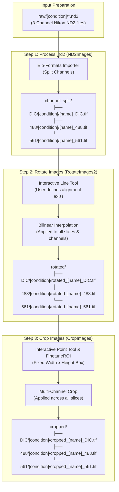

# RotatoROI_II

[](https://www.oracle.com/java/)
[](https://fiji.sc/)
[](https://groovy-lang.org/)
[](https://www.openmicroscopy.org/bio-formats/)
[](https://www.umassmed.edu/)

**RotatoROI_II** is an ImageJ/Fiji plugin developed for the **Amy Walker Lab** at the University of Massachusetts Chan Medical School. It provides a semi-automated, multi-stage image processing pipeline designed for multi-channel confocal and fluorescence microscopy datasets (specifically Nikon `.nd2` multi-channel stacks).

The plugin streamlines sample alignment and region-of-interest (ROI) standardization across multiple fluorescent channels (DIC, 488 nm GFP, and 561 nm mCherry/RFP), ensuring consistent spatial alignment, stack-wide rotation, and precision standardized bounding box cropping for downstream organelle, puncta, and intensity quantification.

---

## Table of Contents

- [Overview & Scientific Context](#overview--scientific-context)
- [Key Features](#key-features)
- [Pipeline Architecture & Data Flow](#pipeline-architecture--data-flow)
- [Directory Hierarchy Specifications](#directory-hierarchy-specifications)
- [Channel Specifications](#channel-specifications)
- [System Requirements & Prerequisites](#system-requirements--prerequisites)
- [Installation & Deployment](#installation--deployment)
  - [Manual Deployment to Fiji](#manual-deployment-to-fiji)
  - [Building from Source](#building-from-source)
  - [Automated Deployment (`deploy.sh`)](#automated-deployment-deploysh)
- [Step-by-Step User Guide](#step-by-step-user-guide)
  - [1. Launching the Plugin](#1-launching-the-plugin)
  - [2. Pipeline Configuration Dialog](#2-pipeline-configuration-dialog)
  - [3. Step 1: Process .nd2](#3-step-1-process-nd2)
  - [4. Step 2: Rotate Images](#4-step-2-rotate-images)
  - [5. Step 3: Crop Images](#5-step-3-crop-images)
- [Audit Logging & Idempotency](#audit-logging--idempotency)
- [Developer Guide](#developer-guide)
  - [Repository Structure](#repository-structure)
  - [Gradle Build Tasks](#gradle-build-tasks)
  - [Java Toolchain & SDKMAN Configuration](#java-toolchain--sdkman-configuration)
- [Troubleshooting & FAQ](#troubleshooting--faq)
- [Citation & Acknowledgments](#citation--acknowledgments)

---

## Overview & Scientific Context

Fluorescence microscopy experiments (such as studies in *C. elegans* or mammalian cell culture) often involve specimens imaged across multiple fluorescent channels with variable orientation. Measuring sub-cellular features—such as mitochondrial network dynamics, puncta distribution, lipid droplet morphology, or nuclear-cytoplasmic translocation—requires:

1. **Automated extraction** of individual channels from proprietary multi-dimensional container formats (`.nd2`).
2. **Synchronized angular rotation** of all imaging channels based on anatomical reference axes (e.g., aligning along the longitudinal worm body or cellular polarity axis).
3. **Identical, standardized bounding-box cropping** across all channels and z-slices to ensure normalized spatial areas across experimental conditions (e.g., Control `EV`, RNAi perturbations like `sams-1`, `sbp-1`, `mdt-15`).

**RotatoROI_II** orchestrates this workflow into a cohesive 3-step pipeline within Fiji, retaining multi-slice z-stack integrity, recording audit logs, and allowing users to pause, inspect, and resume processing incrementally.

---

## Key Features

- **Automated Bio-Formats Channel Splitting**: Decomposes Nikon `.nd2` files into individual 16-bit TIFF files for DIC, 488 nm, and 561 nm channels while preserving experiment conditions.
- **Synchronized Stack Rotation**: Enables users to draw an alignment vector using Fiji's line tool on the DIC reference image; the plugin calculates the precise rotation angle and applies bilinear interpolation across all slices and associated fluorescent channels simultaneously.
- **Precision Standardized Cropping**: Allows the user to select an anchor point; automatically generates a fixed-dimension bounding box (customizable width and height) and launches an interactive fine-tuning dialog (`FinetuneROI`) for pixel-level offset and slice adjustment.
- **Incremental & Idempotent Processing**: Compares source directory manifests against destination directories. Already-processed files are automatically detected and skipped, allowing safe restarts if a pipeline run is cancelled or interrupted.
- **Automated Audit & Diagnostic Logging**: Generates timestamped execution logs (`log-YYYY-MM-DD_HH-mm-ss.txt`) and debug diagnostics (`debug-YYYY-MM-DD_HH-mm-ss.txt`) directly in the experiment root directory.
- **Integrated Help System**: Bundles documentation and visual guides inside the JAR, accessible on-demand via the in-app `Help` button.

---

## Pipeline Architecture & Data Flow



---

## Directory Hierarchy Specifications

RotatoROI_II relies on a standardized directory schema relative to a user-selected **Base Directory** (`[root]`).

### Initial Setup (Before Running)

You must create a `[root]` directory with a `raw` subdirectory containing condition folders:

```text
[root]/
└── raw/
    ├── EV/                     # Experimental Condition A (e.g. Empty Vector control)
    │   ├── specimen001.nd2
    │   └── specimen002.nd2
    └── sams-1/                 # Experimental Condition B (e.g. Gene knockdown)
        ├── specimen001.nd2
        └── specimen002.nd2
```

### Full Pipeline Directory Output

After running all three pipeline stages, the directory structure expands as follows:

```text
[root]/
├── raw/                                # Original 3-channel .nd2 files
│   ├── EV/*.nd2
│   └── sams-1/*.nd2
│
├── channel_split/                      # Output of Step 1 (Individual channel TIFFs)
│   ├── DIC/
│   │   ├── EV/*_DIC.tif
│   │   └── sams-1/*_DIC.tif
│   ├── 488/
│   │   ├── EV/*_488.tif
│   │   └── sams-1/*_488.tif
│   └── 561/
│       ├── EV/*_561.tif
│       └── sams-1/*_561.tif
│
├── rotated/                            # Output of Step 2 (Aligned multi-slice TIFFs)
│   ├── DIC/
│   │   ├── EV/rotated_*_DIC.tif
│   │   └── sams-1/rotated_*_DIC.tif
│   ├── 488/
│   │   ├── EV/rotated_*_488.tif
│   │   └── sams-1/rotated_*_488.tif
│   └── 561/
│       ├── EV/rotated_*_561.tif
│       └── sams-1/rotated_*_561.tif
│
├── cropped/                            # Output of Step 3 (Final standardized cropped ROIs)
│   ├── DIC/
│   │   ├── EV/cropped_*_DIC.tif
│   │   └── sams-1/cropped_*_DIC.tif
│   ├── 488/
│   │   ├── EV/cropped_*_488.tif
│   │   └── sams-1/cropped_*_488.tif
│   └── 561/
│       ├── EV/cropped_*_561.tif
│       └── sams-1/cropped_*_561.tif
│
├── log-YYYY-MM-DD_HH-mm-ss.txt         # Execution timestamp and step summary log
└── debug-YYYY-MM-DD_HH-mm-ss.txt       # Verbose debugging trace
```

> [!IMPORTANT]
> The condition folder names inside `raw/` can be arbitrary (e.g., `control`, `drug_treated`, `RNAi_sbp1`), but they must contain valid multi-channel `.nd2` files. Subdirectories will be mirrored automatically through `channel_split/`, `rotated/`, and `cropped/`.

---

## Channel Specifications

The Bio-Formats reader within RotatoROI_II expects 3-channel acquisitions mapped as follows:

| Bio-Formats Series Index | Channel Identifier | Typical Modality | Output Filename Suffix |
| :--- | :--- | :--- | :--- |
| **`C=0`** | `DIC` | Differential Interference Contrast | `*_DIC.tif` |
| **`C=1`** | `561` | Red / mCherry / Alexa 568 Fluorophore | `*_561.tif` |
| **`C=2`** | `488` | Green / GFP / Alexa 488 Fluorophore | `*_488.tif` |

---

## System Requirements & Prerequisites

- **Fiji / ImageJ**: Fiji (ImageJ 1.54f or later) installed with Bio-Formats enabled.
- **Java Runtime**: Java 8 (JRE 1.8) bundled with Fiji (or compatible OpenJDK).
- **Build Environment (Source builds only)**:
  - Java JDK 17+ (to execute the Gradle build daemon)
  - Java 8 Toolchain installed (e.g., via SDKMAN: `sdk install java 8.0.402-amzn`)
- **Operating System**: macOS, Linux, or Windows.

---

## Installation & Deployment

### Manual Deployment to Fiji

1. Download or build the plugin JAR (`rotatoROI_plugin_II-0.1.1.jar`).
2. Copy the `.jar` file into your Fiji installation's `plugins/` directory:
   - **macOS**: `/Applications/Fiji.app/plugins/`
   - **Linux**: `/path/to/Fiji.app/plugins/`
   - **Windows**: `C:\Users\<User>\Fiji.app\plugins\`
3. Restart Fiji or run `Help > Refresh Menus`.
4. The plugin will be available in the menu bar under:  
   **`Plugins > Process > RotatoROI_II Process`**

### Building from Source

The project uses Gradle Wrapper. Clone the repository and build using JDK 17+:

```bash
# Clone the repository
git clone https://github.com/DanHUMassMed/rotatoROI_plugin_II.git
cd rotatoROI_plugin_II

# Build the JAR (using Java 17 for Gradle, targeting Java 8 toolchain)
JAVA_HOME=~/.sdkman/candidates/java/17.0.6-amzn ./gradlew clean jar
```

The resulting artifact will be located at:
`app/build/libs/rotatoROI_plugin_II-0.1.1.jar`

### Automated Deployment (`deploy.sh`)

For developers on macOS, `deploy.sh` automatically compiles the JAR, copies it to `/Applications/Fiji.app/plugins/`, terminates any active Fiji instance, and relaunches Fiji:

```bash
chmod +x deploy.sh
./deploy.sh
```

---

## Step-by-Step User Guide

### 1. Launching the Plugin

Open Fiji and navigate to `Plugins > Process > RotatoROI_II Process`.

### 2. Pipeline Configuration Dialog

When launched, the primary configuration window appears:


1. **Base Directory**: Click `Browse` and select your experiment root directory (`[root]`).
2. **Execute Pipeline Step**: Check one or more stages:
   - `[x] Process .nd2`: Runs Bio-Formats extraction from `raw/` to `channel_split/`.
   - `[x] Rotate Images`: Runs orientation alignment from `channel_split/` to `rotated/`.
   - `[x] Crop Images`: Runs ROI cropping from `rotated/` to `cropped/`.
3. **Crop Dimensions**: Specify the standardized box size in pixels (default: `Width: 300`, `Height: 200`).
4. **Help**: Opens the embedded HTML user manual and visual diagram in your default web browser.
5. Click **OK** to begin.

---

### 3. Step 1: Process .nd2

- The plugin reads all `.nd2` files located in `[root]/raw/<condition>/`.
- Bio-Formats extracts individual channels, creates the target directories in `[root]/channel_split/`, and saves 16-bit TIFF files.
- A non-blocking progress dialog reports completed files (e.g., `Processed image 1 of 12`).
- If you click **Cancel**, processing halts cleanly before proceeding to the next stage.

---

### 4. Step 2: Rotate Images

- The plugin opens the 3 synchronized channels (`DIC`, `488`, `561`) for each specimen.
- Fiji automatically switches to the **Line Selection Tool** (`line`).
- A prompt instructs:  
  *`"Please draw a line on the image and click OK to continue."`*
- **Action**: Draw a line across the specimen to define its primary anatomical axis (e.g., head-to-tail or cell-axis).
- Click **OK**:
  - The plugin reads the angle of the line.
  - Applies bilinear interpolation rotation to all slices in the stack for all 3 channels.
  - Saves the rotated images to `[root]/rotated/{DIC,488,561}/<condition>/rotated_<name>.tif`.
  - Closes the active windows and automatically opens the next specimen.

---

### 5. Step 3: Crop Images

- The plugin opens the rotated channel images (`DIC`, `488`, `561`).
- Fiji automatically switches to the **Point Tool** (`point`).
- A prompt instructs:  
  *`"Please select a location point to start crop and click OK to continue."`*
- **Action**: Click the desired upper-left origin point for the crop bounding box on the reference image.
- Click **OK**:
  - The plugin places a rectangle matching your configured `cropWidth` and `cropHeight`.
  - An interactive **Finetune Crop** dialog appears (`FinetuneROI`), displaying numeric fields for `X coordinate`, `Y coordinate`, and `Slice`.
  - Adjust coordinates or slice if necessary (the bounding box updates dynamically on the live image).
  - Click **OK** to confirm the crop.
  - The bounding box is cropped across all slices for all 3 channels and saved to `[root]/cropped/{DIC,488,561}/<condition>/cropped_<name>.tif`.

---

## Audit Logging & Idempotency

### Execution Logs

Every pipeline execution generates two timestamped log files in `[root]`:

1. **`log-YYYY-MM-DD_HH-mm-ss.txt`**:
   - Records execution start and finish timestamps.
   - Logs Groovy runtime version and base directory.
   - Summarizes start/end markers for each pipeline step.
   - Records total elapsed duration (in `HH:MM:SS` format).
2. **`debug-YYYY-MM-DD_HH-mm-ss.txt`**:
   - Provides granular debug traces: folder discovery, manifests of files to process, rotation angles, and termination states.

### Incremental Execution & Safe Resumption

RotatoROI_II compares file manifests between source and target directories:
- If 10 images are in `raw/` and 6 have already been processed to `channel_split/`, re-running Step 1 will only process the remaining 4 images.
- If you cancel during Step 2 or 3, re-launching the plugin resumes from the first uncompleted file.
- This prevents accidental re-processing and saves significant time when working with large multi-gigabyte datasets.

---

## Developer Guide

### Repository Structure

```text
rotatoROI_plugin_II/
├── app/
│   ├── build.gradle                # Gradle subproject build definition
│   └── src/
│       ├── main/
│       │   ├── groovy/
│       │   │   ├── com/amywalkerlab/rotato_roi_ii/
│       │   │   │   ├── Constants.groovy               # Preference keys & GUI defaults
│       │   │   │   ├── RotatoROI2Exception.groovy     # Custom runtime exception
│       │   │   │   ├── RotatoROI_II.groovy            # Main PlugIn bootstrap & dialog UI
│       │   │   │   └── process/
│       │   │   │       ├── CropImages.groovy          # Step 3 implementation
│       │   │   │       ├── FinetuneROI.groovy         # Interactive crop dialog listener
│       │   │   │       ├── ND2Images.groovy           # Step 1 implementation
│       │   │   │       ├── ProcessChannelSplitDirectory.groovy # Channel-split base class
│       │   │   │       ├── ProcessDirectory2.groovy   # Directory traversal base class
│       │   │   │       ├── RotateImages2.groovy       # Step 2 implementation
│       │   │   │       └── WaitForUserDialog.groovy   # Non-modal wait dialog
│       │   │   └── io/github/dphiggs01/gldataframe/   # Tabular data & logger utilities
│       │   │       ├── GLDataframe.groovy
│       │   │       ├── GLDataframeException.groovy
│       │   │       └── utils/GLLogger.groovy          # File-based logging utility
│       │   └── resources/
│       │       ├── directory_structure_start.png      # Help dialog visual asset
│       │       ├── instructions.html                  # Embedded HTML help guide
│       │       └── plugins.config                     # ImageJ plugin registry file
│       └── test/
│           └── groovy/                                # Spock unit & integration specs
├── docs/                                              # Screenshots, diagrams & reference PDFs
├── deploy.sh                                          # Local macOS Fiji build & launch script
├── gradlew / gradlew.bat                              # Gradle wrapper scripts
├── settings.gradle                                    # Gradle root configuration
└── README.md                                          # This documentation
```

### Gradle Build Tasks

| Command | Action |
| :--- | :--- |
| `./gradlew jar` | Compiles Groovy/Java sources and produces the plugin JAR. |
| `./gradlew copyJar` | Compiles the JAR and copies it to `/Applications/Fiji.app/plugins/`. |
| `./gradlew clean` | Cleans build caches and output directories. |
| `./gradlew test` | Executes the Spock / JUnit test suite. |

### Java Toolchain & SDKMAN Configuration

ImageJ / Fiji relies on Java 8 byte-code compatibility. The build script enforces this via Gradle Toolchains:

```groovy
java {
    toolchain {
        languageVersion = JavaLanguageVersion.of(8)
    }
}
```

If you use [SDKMAN!](https://sdkman.io/), ensure your environment provides JDK 17+ to run the Gradle daemon while configuring Java 8 as an available candidate:

```bash
# Install required JVM candidates
sdk install java 17.0.6-amzn
sdk install java 8.0.402-amzn

# Set Java 17 for your terminal session
sdk use java 17.0.6-amzn

# Execute the Gradle build
./gradlew clean jar
```

---

## Troubleshooting & FAQ

#### 1. "Input Directory does not exist or contains invalid subdirectory structure"
- **Cause**: Step 2 or Step 3 was launched, but `channel_split/` does not contain the required `DIC`, `488`, and `561` subdirectories.
- **Solution**: Ensure Step 1 (`Process .nd2`) has been executed first, or verify that your `channel_split/` directory has matching subfolders for all three channels.

#### 2. `Unsupported class file major version 69` during Gradle build
- **Cause**: The Gradle daemon was started with Java 25 (`class file major version 69`), which is unsupported by Gradle 8.10.1.
- **Solution**: Point `JAVA_HOME` to a JDK between version 17 and 21 (e.g. `JAVA_HOME=~/.sdkman/candidates/java/17.0.6-amzn ./gradlew jar`).

#### 3. Image stack out of memory error in Fiji
- **Cause**: Multi-slice 3-channel acquisitions opened simultaneously can exceed Fiji's maximum allocated heap memory.
- **Solution**: In Fiji, go to `Edit > Options > Memory & Threads...` and increase the **Maximum memory** allocation (e.g., to 50–75% of your system RAM, such as `16000` MB). Restart Fiji.

#### 4. Files with unexpected channel order
- **Cause**: Bio-Formats imports channels based on acquisition series index (`C=0` -> DIC, `C=1` -> 561, `C=2` -> 488).
- **Solution**: Ensure your microscope acquisition protocol configures DIC as channel 1, 561 nm as channel 2, and 488 nm as channel 3.

---

## Citation & Acknowledgments

- **Development**: Dan Higgins & Amy Walker Lab, University of Massachusetts Chan Medical School.
- **Libraries & Infrastructure**:
  - [ImageJ / Fiji](https://fiji.sc/) (National Institutes of Health)
  - [Bio-Formats](https://www.openmicroscopy.org/bio-formats/) (Open Microscopy Environment)
  - [Apache Groovy](https://groovy-lang.org/)
